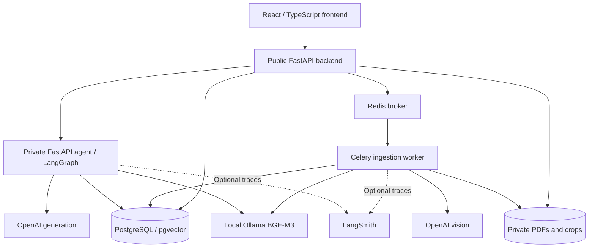

# Technical explanation

Margin uses retrieval-augmented generation to answer questions from selected research papers. It stores
source evidence separately from generated answers, preserves page/region references, and lets users
inspect original PDFs. See [setup](README.md), [evaluation](docs/EVALUATION.md) and
[limitations](docs/LIMITATIONS.md) for operation and measured behavior.

## Architecture

The frontend calls only the public backend. The backend authenticates users, manages documents and
conversations, publishes ingestion jobs, and calls the private agent using a service credential. The
agent answers questions; a separate worker handles expensive ingestion. Shared models/contracts live
in the backend's `research_core` package, installed by both Python services.

## Ingestion pipeline

1. **Accept and queue.** Validate/hash the PDF, reject duplicates, store it privately, commit document/job
   records, then publish the job ID to Redis.
2. **Extract native evidence.** PDFium extracts text and pdfplumber extracts readable tables. Local PDF
   objects identify raster images, vector graphics, unresolved tables and unreadable text.
3. **Inspect selected visuals.** Readable pages send padded visual crops to OpenAI; scanned/unreadable
   pages send the whole page. Text-only pages can skip vision. Transcriptions, cells and descriptions
   are validated and mapped back to physical page coordinates.
4. **Handle truncated output.** Split a crop along its longer axis into overlapping sections and retry
   with the same prompt. Defaults: depth three, minimum split side 192 pixels, overlap 8%. This bounds
   each original region to eight leaf sections/15 logical requests, excluding SDK retries. Deduplicate
   overlapping text, keep table fragments separate, and retain the original unsplit image.
5. **Index and publish.** Chunk textual evidence and embed it with local BGE-M3 (1,024 dimensions).
   Store vectors alongside typed text/table/figure evidence and provenance. Publish a ready version
   atomically only after the worker's current attempt succeeds.

Native text and visual transcriptions/descriptions share the text embedding space. **Images go directly
into the vision model during ingestion; there are no image embeddings.** Q&A uses indexed descriptions,
not another image-model call. Original crops support human verification.

Malformed outputs, quota errors and exhausted split bounds fail ingestion. There is no alternate OCR
prompt or local vision fallback. Some unusable numeric bounds fall back to the input region; missing
or nonnumeric fields can fail schema validation earlier. Successful extraction is cached by source,
model and extraction settings. Reprocessing retains the old ready version until publication succeeds.

## Answering pipeline

1. Check conversation ownership and require selected documents to be ready.
2. Resolve follow-up references for retrieval, embed the query, and search only selected documents.
3. Combine exact vector ranking and PostgreSQL full-text ranking using reciprocal rank fusion.
   Retrieve up to eight parent evidence items, using the best matching text chunk per parent.
4. Compose a structured answer from retrieved text, tables and indexed figure descriptions. Permit
   one retrieval-query rewrite for insufficient coverage; return full, partial or no answer.
5. Validate evidence IDs and copied numbers, construct citations from stored metadata, recheck source
   scope and save the answer. Original tables/crops can accompany it.

Citation checks establish source identity and some copied-value consistency, not semantic entailment.
Follow-up resolution currently improves retrieval without consistently supplying the resolved context
to composition. Both limitations caused failures in the [recorded experiment](docs/EVALUATION.md).

## Key choices and tradeoffs

| Choice | Reason and tradeoff |
| --- | --- |
| Public backend/private agent | Separates authorization from model orchestration; adds service coordination. |
| PostgreSQL, pgvector and full-text search | Keeps evidence, provenance, jobs and retrieval together. Exact search fits the demo; larger collections need indexing and latency measurements. |
| Local BGE-M3 embeddings | Avoids embedding API fees; requires a local server and compute. Requests validate dimensions and disable silent truncation. |
| OpenAI `gpt-5.4-mini` for chat and vision | One hosted integration with structured responses; introduces cost, quota and extraction variability. Answer reasoning is `low`, vision reasoning `none`. |
| Native extraction before selective vision | Reduces model calls and preserves native text; region detection and table reconstruction can miss content. |
| Bounded LangGraph flow | Explicit stages make retries/traces inspectable; validation can over-reject valid answers. |
| Celery worker with direct publication | Keeps ingestion outside HTTP requests. Manual Retry handles failures; commit-to-queue delivery is not atomic. |
| Versioned evidence and original crops | Preserves availability during reprocessing and supports verification; requires a future physical-retention policy. |
| Optional LangSmith experiments | Captures real queries, traces, costs and feedback; exports document content and still needs independent source review. |

## Authentication, persistence and configuration

Email/password authentication uses Argon2id, short-lived JWTs in browser memory and hashed refresh
tokens in PostgreSQL. HttpOnly refresh cookies rotate transactionally; reuse revokes the session.
Requests check account/session validity, role and conversation ownership. Cookie operations check
origins and, where applicable, CSRF tokens. Cross-tab identity changes clear state and discard stale
requests. The six-character demo password minimum is not a production policy.

Readers query shared papers; administrators also manage documents. Neither can read another user's
conversations. Separate database roles restrict backend, worker and agent access; the agent cannot
read authentication tables. Local processes load the same root `.env`, so role permissions do not
imply OS-level secret isolation. Compose supplies selected settings per service.

Alembic coordinates migrations. Retrieval filters embeddings by model/dimension; retained legacy
vectors require reprocessing to enter BGE-M3 search. Pages are 1-based physical PDF pages; boxes use
top-left PDF coordinates. Attempt tokens and renewable leases reject stale worker publication.
PostgreSQL is the durable job authority, not Redis.

The uv workspace lockfile controls terminal Python dependencies; Docker installs under
`requirements.lock` constraints. npm has a separate lockfile. Development runs infrastructure in
Docker and apps through `uv`/`npm`; packaged Compose builds all services. There is no custom launcher.

## Evaluation and next decisions

Live experiments capture final evidence, per-stage latency, usage and estimated query cost. Code
checks cover retrieval/provenance, exact responses and synthetic canaries; a fixed model judge assesses
quality/security. The default judge shares the generator model, and the coding assistant reviewed
references. Scores therefore need calibration and independent review.

The [evaluation report](docs/EVALUATION.md) includes actual successes and failures. Priorities are
source extraction, follow-up context and validation fixes, then held-out evaluation and durable
queue delivery. [Limitations](docs/LIMITATIONS.md) separates these plans from implemented behavior.
